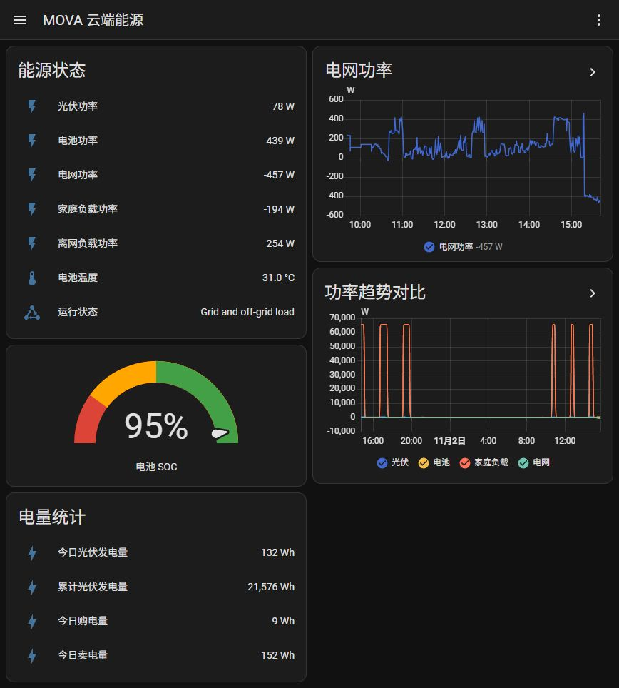
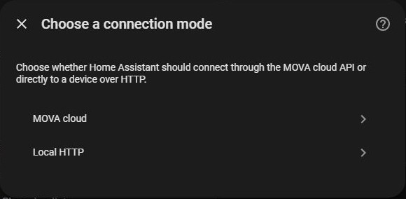
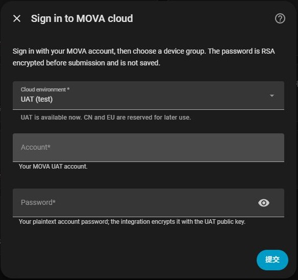

# MOVA Energy

Connect MOVA energy storage devices to Home Assistant to monitor energy use, view battery status and adjust device settings.
Choose **MOVA cloud** or **Local HTTP** during setup. Configuration is handled in Home Assistant's interface.



Example dashboard from a test installation. Measurements and history are illustrative; available values depend on your device and firmware.

## Features

- Monitor solar, battery, grid, household and EPS (backup output) power.
- View battery charge level, temperature, operating status and electricity meter connectivity.
- Track daily solar generation, daily grid import/export and cumulative solar generation where available.
- Adjust charging/discharging power limits, battery charge limits and work mode.
- Use Home Assistant's built-in cards, history, statistics and automations.

## Requirements and availability

- **Home Assistant 2026.10.0 or newer.**
- **Cloud:** a MOVA UAT account with access to a device group, and internet connectivity from Home Assistant.
- **Local:** a compatible MOVA energy device with local HTTP support, reachable from Home Assistant.

This integration is under development. Cloud login currently supports **UAT (test)** only; **CN** and **EU** are reserved
and cannot be used yet. A production MOVA account may not have access to UAT. Local support depends on device firmware;
this repository does not yet provide a confirmed compatibility list for all MOVA models.

## Installation

### Manual installation

1. Download the project archive from this repository.
2. Copy its `custom_components/mova_energy` folder into your Home Assistant configuration directory:

   ```text
   <config>/custom_components/mova_energy/manifest.json
   ```

3. Restart Home Assistant.
4. Open **Settings → Devices & services → Add integration** and search for **MOVA Energy**.

When updating manually, replace the integration folder with the new version and restart Home Assistant.
Your integration settings are stored separately by Home Assistant.

### HACS

HACS installation requires a published GitHub repository compatible with HACS. Once that repository is available,
add its URL under **HACS → Custom repositories**, select **Integration**, download **MOVA Energy**, and restart
Home Assistant. The repository specifies **HACS 2.0.5 or newer**. HACS is optional for manual installation.

## Add your device

Choose a connection mode when adding MOVA Energy:



### MOVA cloud

1. Choose **MOVA cloud**.
2. Select **UAT (test)** and enter your MOVA UAT account and password.
3. Submit the form, then select a device group by its name.
4. Complete setup and open the device to see its measurements and controls.



The integration does not save your plaintext password. Home Assistant stores the login tokens, which the integration
renews automatically when needed. If the session can no longer be renewed, Home Assistant asks you to sign in again.

To add another device group, add another MOVA Energy integration and select that group.

### Local HTTP

1. Choose **Local HTTP**.
2. Enter the device's hostname or IP address. This field is required.
3. Leave the port at **80**, unless your device uses a different HTTP port.
4. Submit the form to check the device and complete setup.

The device must be reachable from the Home Assistant runtime, including its container or virtual machine if used.
A browser on your computer reaching the device does not by itself confirm that Home Assistant can reach it.

See [Getting started](docs/user/GETTING_STARTED.md) for the installation checklist.

## Measurements and controls

Available measurements depend on what the device or cloud reports. Missing measurements appear as **Unknown**;
a failed connection can make entities **Unavailable**.

| Measurement                     | Unit or meaning                                                          |
| ------------------------------- | ------------------------------------------------------------------------ |
| PV power                        | Solar generation in W                                                    |
| Battery power                   | W; negative means charging, positive means discharging                   |
| Grid power                      | Grid power in W                                                          |
| Load power                      | Household load in W; calculated from reported power values in cloud mode |
| EPS power                       | Backup output power in W                                                 |
| Battery SOC                     | Battery charge level in %                                                |
| Battery temperature             | °C                                                                       |
| Run status                      | Off, standby, off-grid, on-grid, fault, or grid with backup load         |
| Meter online                    | Electricity meter connectivity                                           |
| PV daily energy                 | Today's solar generation in Wh                                           |
| PV total energy                 | Cumulative solar generation in Wh; cloud only                            |
| Grid import/export daily energy | Today's purchased/exported energy in Wh                                  |
| Firmware version                | Reported device firmware version                                         |

The integration provides these controls:

| Control                            | Availability                              |
| ---------------------------------- | ----------------------------------------- |
| Charge and discharge power limits  | Cloud and local                           |
| Upper and lower battery SOC limits | Cloud and local                           |
| Backup SOC reserve                 | Cloud and local                           |
| Work mode                          | Cloud and local; available choices differ |
| Backup enabled switch              | Cloud only                                |

Cloud work mode choices are **Self-consumption**, **Dynamic EV** and **Custom mode**. Local mode exposes the work modes
supported by the local interface. Actual limits and supported behavior depend on the device firmware.

After changing a setting, the integration reads it back. Cloud commands may take time to apply; a submitted command
is not confirmation that the device has executed it. Controls display reported values, including any limits applied
by the device.

## Updates and options

Without a saved override, measurements refresh every **60 seconds in cloud mode** or **10 seconds in local mode**.
An interval saved through the integration's **Configure** dialog takes precedence.

The current interval option uses **hours**, accepts **0.25–24 hours**, and initially shows **1 hour** when no override
has been saved. Saving that form can therefore make updates much slower than the connection-mode defaults.
See [Configuration](docs/user/CONFIGURATION.md) for details.

For an immediate refresh, open **Developer tools → Actions**, select **MOVA Energy: Refresh data**, choose the
integration entry and run the action.

## Dashboard

The screenshot above uses Home Assistant's built-in cards. Follow the
[complete dashboard example](docs/user/EXAMPLES.md) to create your own view with power history, a battery gauge and
energy counters. Replace the example entity IDs with the IDs from your installation.

The integration creates devices and entities; it does not automatically create this dashboard or sidebar entry.
History and statistics need time to accumulate after setup.

## Troubleshooting

| Symptom                                     | What to check                                                                                |
| ------------------------------------------- | -------------------------------------------------------------------------------------------- |
| MOVA Energy is missing from Add integration | Check the installation path and restart Home Assistant.                                      |
| Cloud login fails                           | Use a UAT account and check its device-group permissions. CN and EU are not available yet.   |
| No device groups or devices                 | Confirm the account can access a group that contains a device.                               |
| Local setup fails                           | Check the host, port, firmware support and connectivity from Home Assistant.                 |
| Measurements are Unknown                    | The device or cloud may not have reported those measurements yet.                            |
| Entities are Unavailable                    | Check connectivity and the integration's error logs. Complete reauthentication if requested. |
| Updates are slow                            | Check whether a saved interval overrides the default; the option is measured in hours.       |
| A control returns to its previous value     | Wait for the device to report the setting; firmware may reject or limit the requested value. |
| Graphs are empty                            | Check the entity IDs and Recorder settings, then allow time for history and statistics.      |

Open **Settings → System → Logs** and look for `custom_components.mova_energy`.
To collect more detail, use **Enable debug logging** on the integration's menu, reproduce the problem, then disable
it to download the log.

You can also download diagnostics from the integration's menu. Credentials and tokens are redacted, but review logs,
diagnostics and screenshots for hostnames and device identifiers before sharing them. When reporting a problem,
include your Home Assistant version, integration version, connection mode and steps to reproduce it.

## Contributing

Source code is in `custom_components/mova_energy/`. See [CONTRIBUTING.md](CONTRIBUTING.md) and the
[development documentation](docs/development/ARCHITECTURE.md) to get started.

This repository was created from the
[HACS integration blueprint](https://github.com/jpawlowski/hacs.integration_blueprint).

## License

[MIT License](LICENSE).
