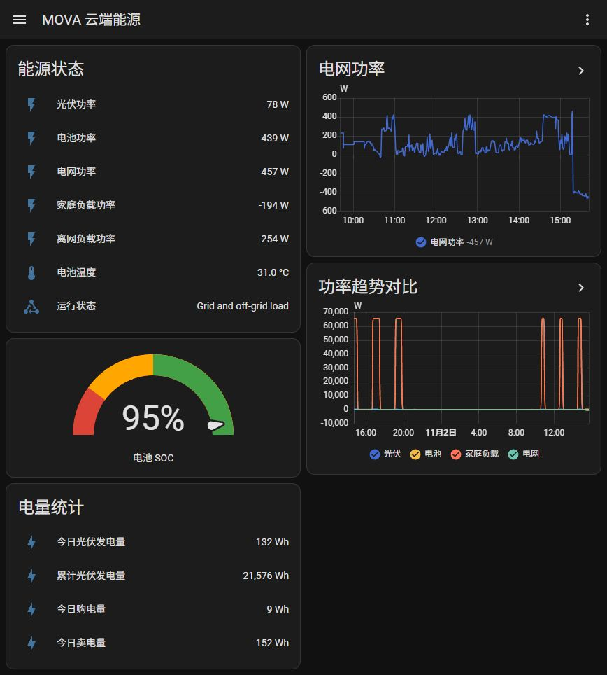

# MOVA Energy examples

## Cloud energy dashboard

This example shows live energy values, grid power history, a comparison of power statistics, battery SOC and energy
counters. The card titles below are in Chinese and can be renamed.



The screenshot shows test data. Values and history depend on your device and firmware.

### Before you start

- Add the MOVA cloud integration and confirm that its entities have values.
- Find the actual entity IDs in **Settings → Devices & services → Entities**, or **Developer tools → States**.
- Replace every `sensor.mova_sme_ge2607_*` reference below with the corresponding entity ID from your installation.
  Names may differ by device, group, language or previous renaming; do not assume the prefix alone is sufficient.
- `pv_total_energy` is currently a cloud-only entity. Remove that row if the entity is absent, including when adapting
  this example for a local device.

### Add a dashboard

1. Open **Settings → Dashboards** and create a new, empty dashboard. Enable its sidebar entry if desired.
2. Open the dashboard, choose **Edit dashboard**, then open the **Raw configuration editor** from the menu.
3. For a new, empty dashboard, paste the complete configuration below. For an existing dashboard, add the view under
   its existing `views:` list instead of replacing the whole configuration.
4. Replace the entity IDs and save.

This is a complete dashboard configuration beginning with `views:`. To add just one card through **Add card → Manual**,
copy only the corresponding `type: ...` card block, without the surrounding `views:` or `cards:` list.

```yaml
views:
  - title: MOVA 云端能源
    path: overview
    icon: mdi:home-lightning-bolt
    cards:
      - type: entities
        title: 能源状态
        show_header_toggle: false
        entities:
          - entity: sensor.mova_sme_ge2607_pv_power
            name: 光伏功率
          - entity: sensor.mova_sme_ge2607_battery_power
            name: 电池功率
          - entity: sensor.mova_sme_ge2607_grid_power
            name: 电网功率
          - entity: sensor.mova_sme_ge2607_load_power
            name: 家庭负载功率
          - entity: sensor.mova_sme_ge2607_eps_power
            name: 离网负载功率
          - entity: sensor.mova_sme_ge2607_battery_temperature
            name: 电池温度
          - entity: sensor.mova_sme_ge2607_run_status
            name: 运行状态
      - type: history-graph
        title: 电网功率
        hours_to_show: 6
        entities:
          - entity: sensor.mova_sme_ge2607_grid_power
            name: 电网功率
      - type: statistics-graph
        title: 功率趋势对比
        chart_type: line
        period: 5minute
        days_to_show: 1
        stat_types:
          - mean
        entities:
          - entity: sensor.mova_sme_ge2607_pv_power
            name: 光伏
          - entity: sensor.mova_sme_ge2607_battery_power
            name: 电池
          - entity: sensor.mova_sme_ge2607_load_power
            name: 家庭负载
          - entity: sensor.mova_sme_ge2607_grid_power
            name: 电网
      - type: gauge
        entity: sensor.mova_sme_ge2607_battery_soc
        name: 电池 SOC
        min: 0
        max: 100
        needle: true
        severity:
          red: 0
          yellow: 20
          green: 50
      - type: entities
        title: 电量统计
        show_header_toggle: false
        entities:
          - entity: sensor.mova_sme_ge2607_pv_daily_energy
            name: 今日光伏发电量
          - entity: sensor.mova_sme_ge2607_pv_total_energy
            name: 累计光伏发电量
          - entity: sensor.mova_sme_ge2607_grid_import_daily_energy
            name: 今日购电量
          - entity: sensor.mova_sme_ge2607_grid_export_daily_energy
            name: 今日卖电量
```

### How the cards work

| Card               | Purpose                                                                           |
| ------------------ | --------------------------------------------------------------------------------- |
| Energy status      | Shows the most recently reported measurements and run status.                     |
| Grid power history | Shows recorded state changes over the last six hours.                             |
| Power comparison   | Shows five-minute mean values for the last day.                                   |
| Battery SOC gauge  | Shows battery percentage, with red below 20%, yellow from 20% and green from 50%. |
| Energy counters    | Shows daily generation, daily import/export and cumulative PV generation.         |

The history graph needs Recorder history for its entities. The statistics graph needs Recorder statistics; the
integration's power sensors use `state_class: measurement`. A newly added entity needs time to accumulate data, so
wait for a five-minute statistics interval before expecting points. Check Recorder exclusions if graphs stay empty.
These cards display stored history and current entity values; they do not change the integration's polling interval.

The dashboard is separate from the integration. It uses Home Assistant's built-in cards and requires no additional
frontend plugin. Users create it themselves; installing the integration does not automatically add this dashboard.

## Refresh action

To refresh an integration entry immediately, open **Developer tools → Actions**, select **MOVA Energy: Refresh data**,
and choose the integration entry. The equivalent YAML is:

```yaml
action: mova_energy.refresh_data
data:
  config_entry_id: YOUR_CONFIG_ENTRY_ID
```

Replace `YOUR_CONFIG_ENTRY_ID` with the ID of the entry to refresh.

## Related documentation

- [README](../../README.md) — installation, supported entities and troubleshooting.
