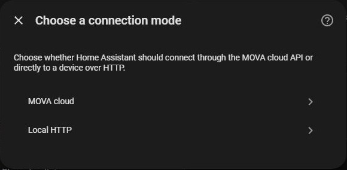

# Getting started with MOVA Energy

## Before you install

- Use **Home Assistant 2026.10.0 or newer**.
- For cloud mode, prepare a MOVA **UAT** account with access to a device group. CN and EU are not available yet.
- For local mode, confirm your device firmware supports local HTTP access and that Home Assistant can reach it.

Not every MOVA device is supported. Compatibility depends on the device and its firmware.

## Install the integration

1. Download this repository's project archive.
2. Copy `custom_components/mova_energy` into the `custom_components` directory inside your Home Assistant
   configuration directory. The result should contain `custom_components/mova_energy/manifest.json`.
3. Restart Home Assistant.
4. Open **Settings → Devices & services → Add integration**.
5. Search for **MOVA Energy**.

HACS is optional. For the conditions and steps for HACS installation, see the [README](../../README.md#hacs).

## Choose a connection mode

### MOVA cloud

1. Choose **MOVA cloud**.
2. Select **UAT (test)**.
3. Enter your MOVA UAT account and password, then submit.
4. Select a device group by its name and complete setup.

Your plaintext password is not saved. The integration renews its login session automatically when possible;
Home Assistant will ask you to sign in again if renewal fails.

If no groups appear, check that the account has permission to access a device group. A production account may not
have access to the test environment.

### Local HTTP

1. Choose **Local HTTP**.
2. Enter the device's hostname or IP address.
3. Use the default port **80**, or enter the HTTP port used by your device.
4. Submit to validate the connection and complete setup.

For Docker or virtual-machine installations, connectivity must work from that environment. `localhost` refers to
the environment running Home Assistant, so use the device's reachable network address.

## Check your device

Open **Settings → Devices & services → MOVA Energy** and select the device. Check its measurements and controls.
Available values depend on the device and connection mode; missing values can appear as **Unknown**.

Default updates occur every **60 seconds for cloud** or **10 seconds for local**, unless you save an interval override.
See [Configuration](CONFIGURATION.md) before changing the interval: the current option is measured in hours.

## Create a dashboard

Follow the [dashboard example](EXAMPLES.md) to add energy measurements, power graphs and a battery gauge.
Use the actual entity IDs listed under **Settings → Devices & services → Entities**.

The example uses built-in Home Assistant cards and requires no extra frontend plugin. The dashboard and its sidebar
entry are created separately from the integration.

## If something goes wrong

See [Troubleshooting](../../README.md#troubleshooting) for connection, authentication, update and graph problems.
